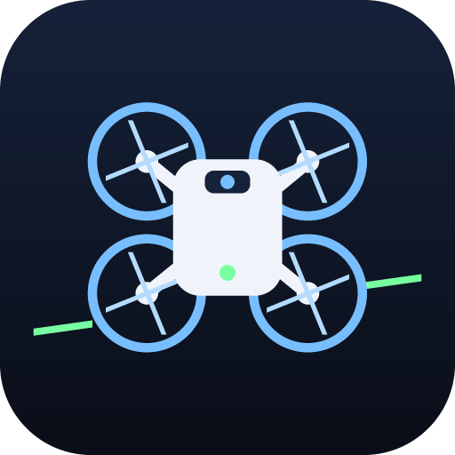
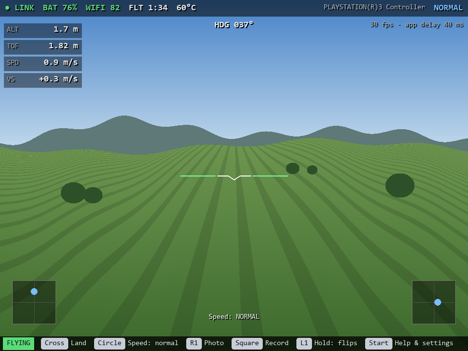
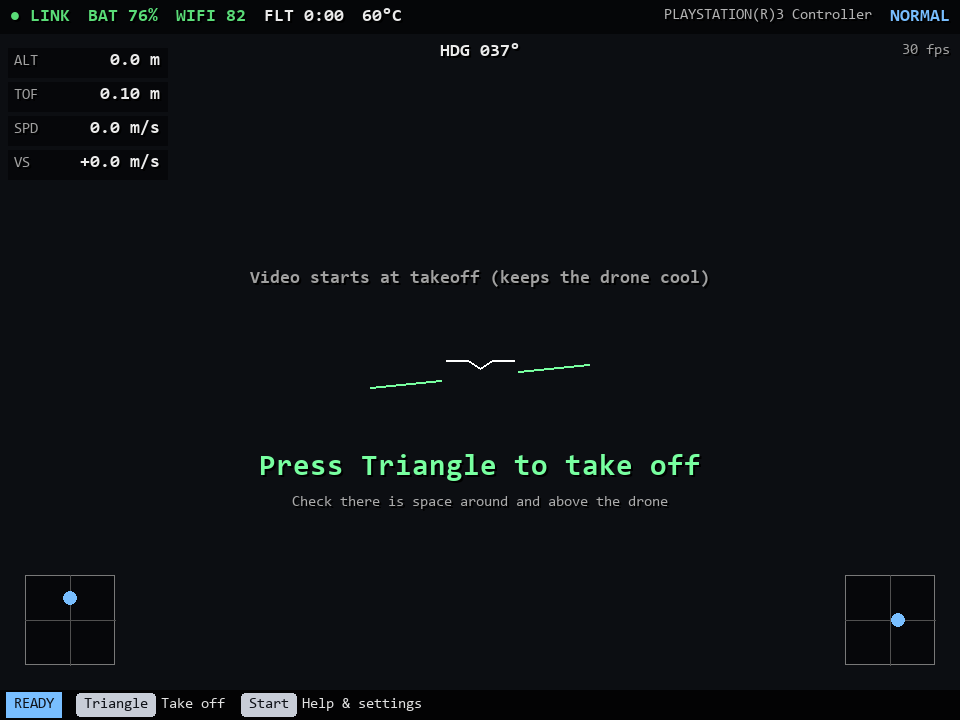
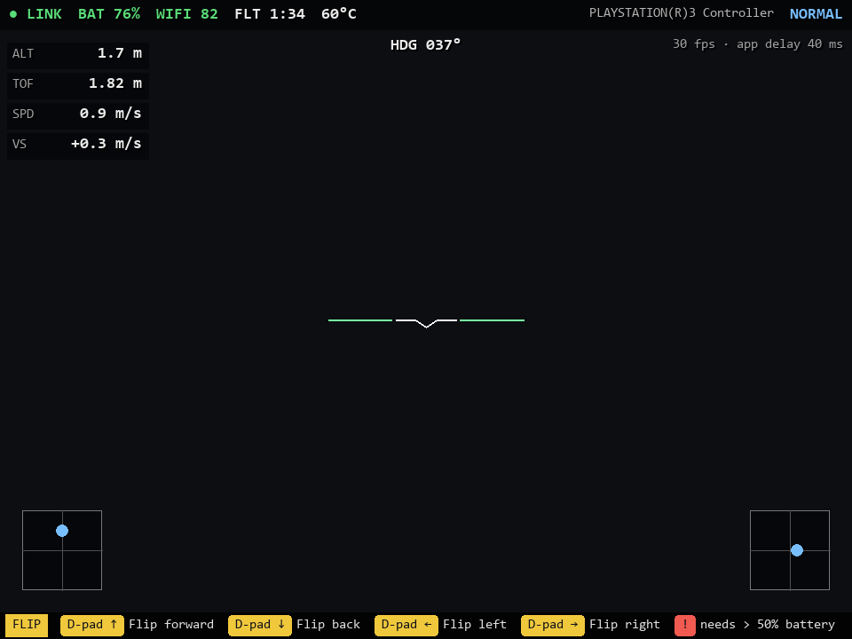
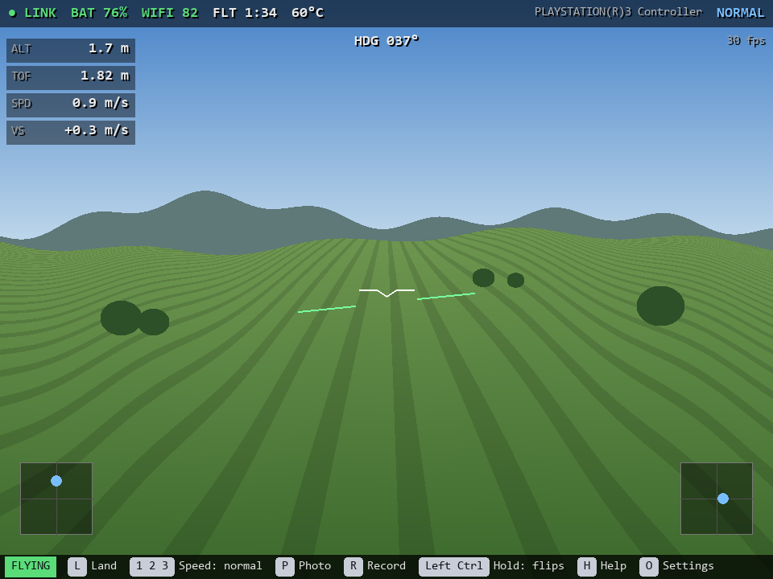
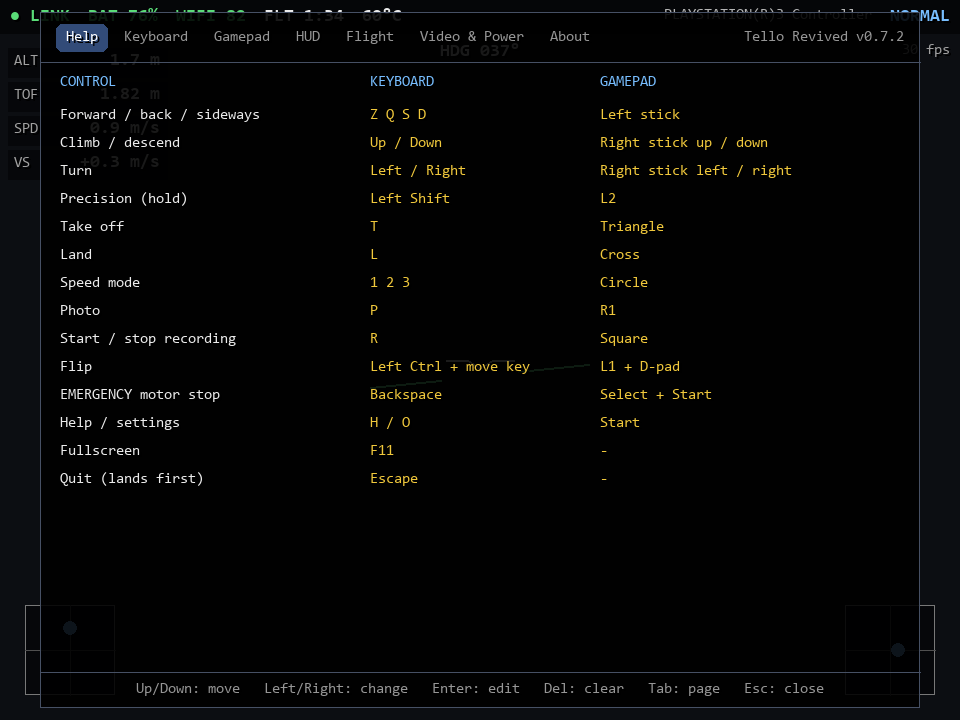
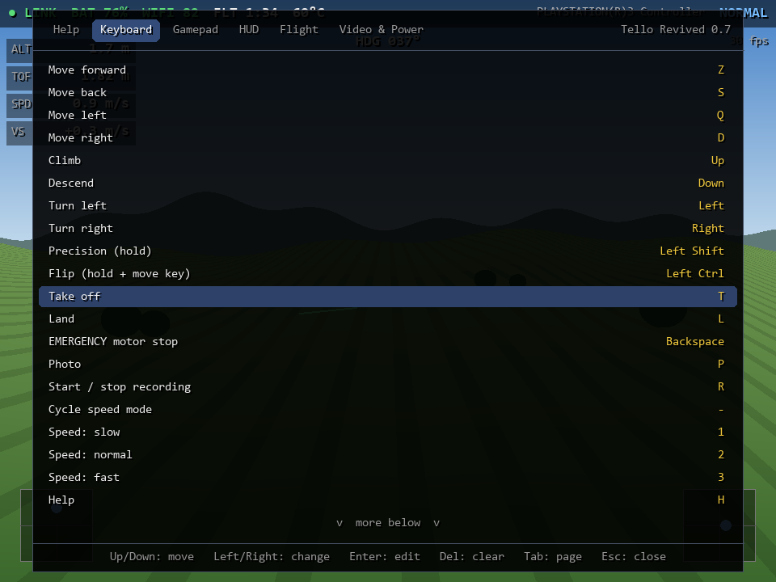
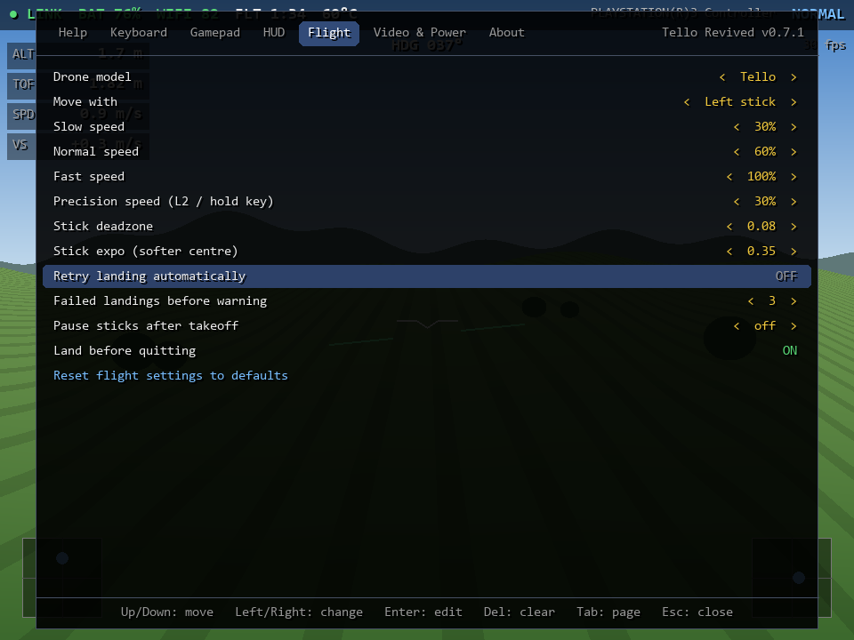
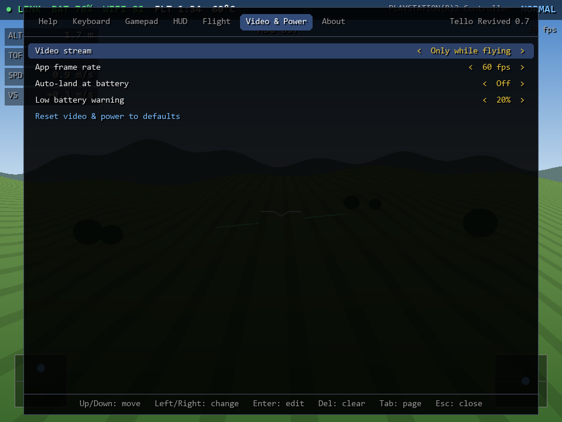
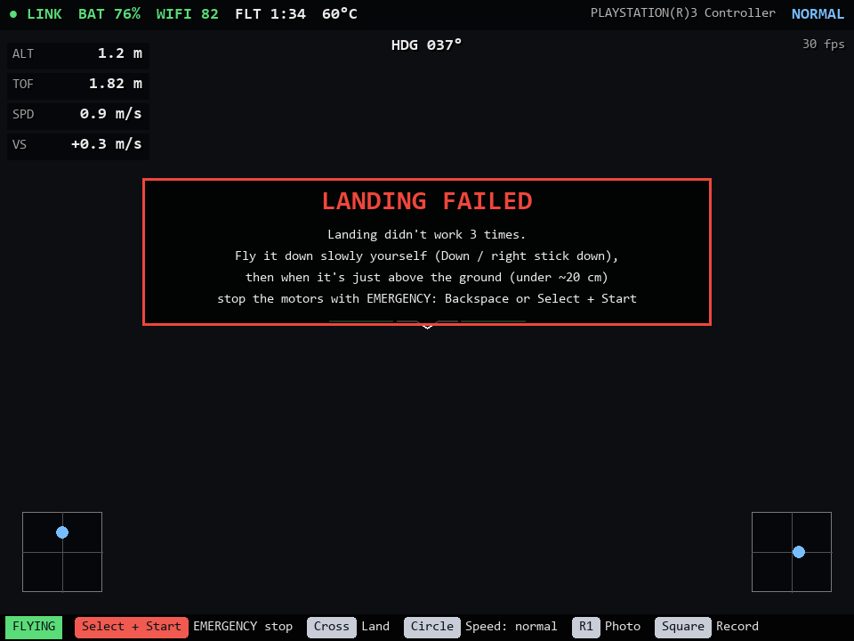

<p align="center"></p>

# TelloRevived

Fly a Ryze/DJI Tello from your PC with a PS3 controller (via DsHidMini) or the keyboard. You get a big live video feed, a flight HUD, photo and video recording, and a settings screen where everything can be changed.



*Screenshots use a simulated camera image and telemetry. Run `tools\make_screenshots.py` to regenerate them.*

## Features

- **Live video** in a resizable window or fullscreen (F11).
- **Button guide** at the bottom that shows only the buttons you need right now, for the pad or the keyboard, whichever you used last.
- **HUD:** battery, Wi-Fi signal, flight time, temperature, altitude, height above ground, speed, climb rate, heading, a horizon line, and stick positions. Each element can be turned off.
- **Gamepad and keyboard at the same time.** Keys follow their physical position, so `WASD` is `ZQSD` on AZERTY keyboards.
- **Settings screen.** Rebind every key and pad button, swap the sticks, adjust speeds and stick feel, change landing behaviour, and pick battery-saving options. Everything is saved to `config.json`.
- **Photos and recordings** are saved to `media\`. Recordings are `.mp4` files of the drone's original stream, with no re-encoding.
- **Landing help:** optional automatic retries, and a warning with instructions if landing keeps failing.
- **Battery saving:** video only while flying or off, lower stream quality, auto-land at a battery level, and a lower app frame rate.

## Download

Ready-to-run builds for Windows, Linux and macOS are made by GitHub Actions: get them from the repository's **Releases** page, or from the **Actions** tab (open a run, then **Artifacts**).

| System | File | How to start |
|---|---|---|
| Windows | `TelloRevived-windows-x64.exe` | Double-click it. Settings and media are saved next to the exe. |
| Linux | `TelloRevived-linux-x64.tar.gz` | Extract it and run `TelloRevived/TelloRevived`. |
| macOS | `TelloRevived-macos-arm64.zip` (Apple silicon) or `-x64.zip` (Intel) | Unzip and open **Tello Revived.app**. It isn't signed, so the first time right-click it and choose **Open**. Settings and media go in `~/Tello Revived`. |

## Setup

1. Turn on the Tello and connect the computer's Wi-Fi to `TELLO-XXXXXX`.
2. Start the downloaded app, or run from source: double-click `run.bat` on Windows, or run `./run.sh` on Linux and macOS. The first time, the script creates `.venv` and installs `pygame-ce`, `av` and `numpy`.
3. On Windows the firewall asks about the app (or Python) on the first run. Allow it on **Public** networks, because Windows treats the Tello's Wi-Fi as public. If you don't, there will be no video and no telemetry.

When the drone is connected, the screen tells you which button takes off. Press **H** or **Start** for all the controls and **O** for settings.

## Button guide

The bar at the bottom changes with what the drone is doing, so you rarely need the help screen:

| On the ground | Flying | Holding the flip button (L1) |
|---|---|---|
|  |  |  |

It shows the pad's buttons after you touch the pad and the keyboard's keys after you press a key:



Photo and Record only appear while the camera is streaming. With video set to **Only while flying**, that means after takeoff. A recording stops and is saved by itself when the video stops, for example after landing. While landing, or after a landing fails, the emergency stop is added to the front. You can turn the bar off in **Settings → HUD**.

## Default controls

| | Keyboard | Gamepad |
|---|---|---|
| Forward / back / sideways | `W A S D` (`Z Q S D` on AZERTY) | Left stick |
| Climb / descend | `Up` / `Down` | Right stick up / down |
| Turn | `Left` / `Right` | Right stick left / right |
| Precision (slow, hold) | `Left Shift` | `L2` (analog) |
| Take off / land | `T` / `L` | Triangle / Cross |
| Speed mode | `1` `2` `3` | Circle (cycles) |
| Photo / record | `P` / `R` | R1 / Square |
| Flip | `Left Ctrl` + move key | L1 + D-pad |
| **Emergency motor stop** | `Backspace` | **Select + Start** |
| Help / settings | `H` / `O` | Start |
| Fullscreen / quit | `F11` / `Esc` | |

To swap which stick moves and which climbs and turns, go to **Settings → Flight → Move with**. Set your drone under **Settings → Flight → Drone model** (Tello, Tello EDU or RoboMaster TT); settings your drone doesn't support are hidden.

## Settings screen

| Help | Keyboard |
|---|---|
|  |  |
| **Flight** | **Video & Power** |
|  |  |

The **About** page shows the version, a link to this repository, a button that opens the photos and videos folder, and where your settings are saved.

Controls inside the settings screen:

- **Keyboard:** `Up`/`Down` to move, `Left`/`Right` to change a value, `Enter` to edit, `Del` to clear a binding, `Tab` to switch page, `Esc` to close.
- **Gamepad:** D-pad, Cross to edit, Square to clear, L1/R1 to switch page, Circle to close.
- **Mouse:** click a value. Click its left half, or right-click, to go back.

To rebind something, select it and press the new key or button. A red value means two actions share it. While the settings screen is open, only the gamepad flies the drone, and the emergency stop still works.

## Landing

By default, landing sends a single `land` command, as in the original app. The app then watches the descent. If the drone stops descending, that try counts as failed. After **Failed landings before warning** tries (3 by default) you get this warning:



In that case, fly it down slowly yourself. When it's just above the ground, use the emergency stop.

Turn on **Settings → Flight → Retry landing automatically** if you want the app to keep resending `land` for you. It also stops stick commands while landing, because they can cancel a landing. Moving a stick cancels the automatic landing.

## Saving battery

All of these are on the **Video & Power** page:

- **Video stream** is **Only while flying** by default, because the Tello gets very hot when it streams sitting on the ground. Choose **On** to see the camera before takeoff, or **Off** for no video at all.
- **Stream resolution / frame rate / bitrate** lower the stream quality. Only the RoboMaster TT (SDK 3.0) supports them, so they only appear when **Settings → Flight → Drone model** is set to **RoboMaster TT**. A regular Tello (SDK 1.3) or Tello EDU (SDK 2.0) can't get them through a firmware update, and everything else in the app works on all three.
- **Auto-land at battery** lands once per flight when the battery reaches that level.
- **App frame rate** lowers how often the window is redrawn, which saves laptop battery. Nothing is drawn while the window is minimised.

## Controller notes

- DsHidMini in **SDF** or **XInput** mode works with SDL's standard mapping.
- In XInput mode, Windows grabs the PS button for the Xbox Game Bar. That's why Start opens help and settings by default. To stop this, turn off the Game Bar's controller button in Windows Settings → Gaming → Xbox Game Bar.
- If the top bar shows your pad as `(raw)`, run `run.bat --joytest`, then put the axis and button numbers into `RAW_MAP` in `tello_revived.py`.

## Safety

- The **emergency stop cuts the motors immediately, and the drone falls.** Use it only when the drone is very low, or when something is going wrong.
- If the pad disconnects or you let go of everything, the drone hovers.
- Quitting while flying lands first. Press the quit key again to quit right away.
- Flips need more than 50% battery.

## Project layout

| File | What it is |
|---|---|
| `tello_revived.py` | The app: drone link, video, input, HUD |
| `menu.py` | Help and settings screen |
| `settings.py` | Defaults, `config.json` loading and saving, key and button names |
| `assets/make_logo.py` | Draws `assets/logo.png` and the window icon |
| `tools/make_screenshots.py` | Renders the README screenshots without a drone |
| `tools/build.py` | Builds the standalone app for the current system |
| `.github/workflows/build.yml` | Builds and tests Windows, Linux and macOS versions on GitHub |

## Building the app yourself

```
python -m pip install -r requirements-build.txt
python tools/build.py
```

The result is in `dist/`. Use a separate virtual environment for this if you like, so PyInstaller stays out of the one `run.bat` uses. `TelloRevived --selftest` starts the app without a drone, draws a few frames and exits; the GitHub workflow runs it on every build.

To publish a release, push a tag such as `v1.0`. The workflow builds all four versions and attaches them to a GitHub release.
