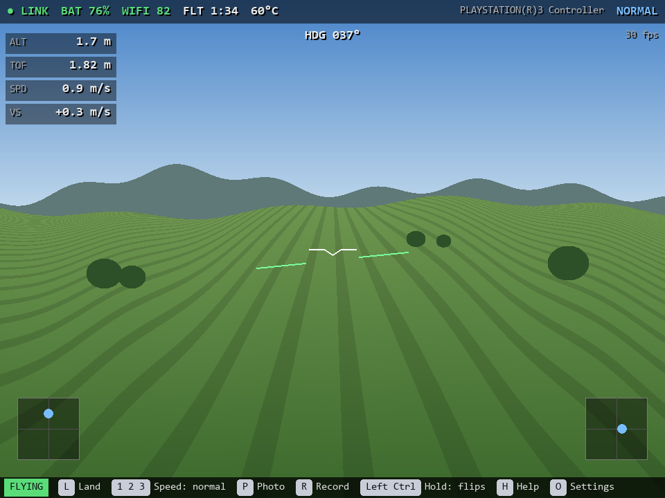
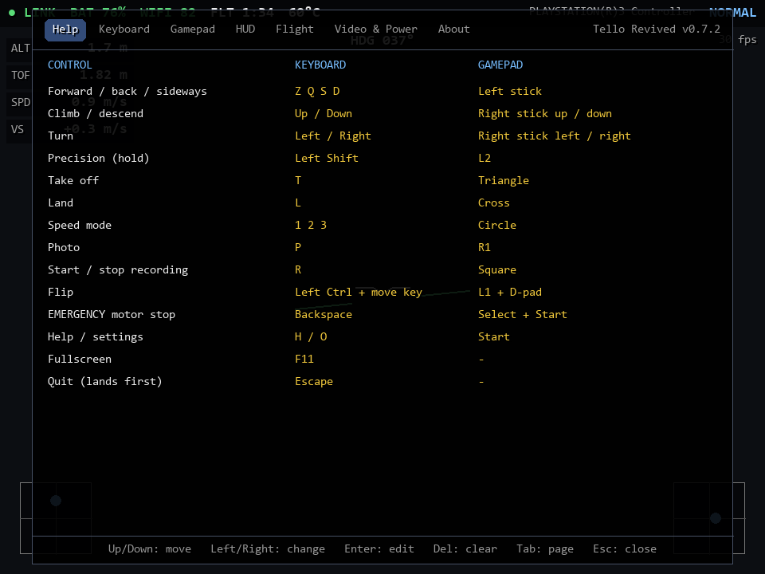
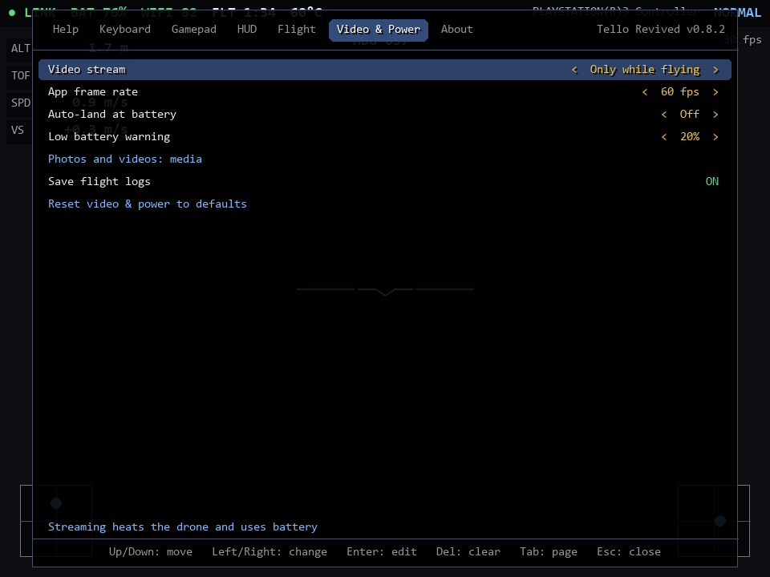
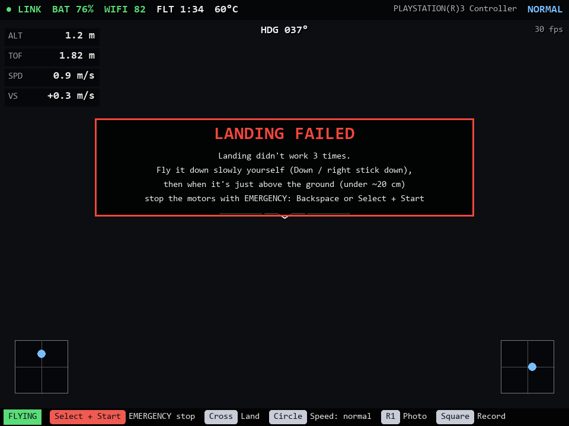

# User guide

- [Button guide](#button-guide)
- [Controls in detail](#controls-in-detail)
- [Language and units](#language-and-units)
- [Video delay](#video-delay)
- [Settings screen](#settings-screen)
- [Throw & go](#throw--go)
- [Landing](#landing)
- [Battery and heat](#battery-and-heat)
- [Gamepads](#gamepads)
- [Connecting to the drone's Wi-Fi](#connecting-to-the-drones-wi-fi)
- [Sound and vibration alerts](#sound-alerts)
- [Flight logs](#flight-logs)
- [Firewall](#firewall)

## Button guide

The bar at the bottom shows the buttons for what the drone is doing right now: take off on the ground; land, speed, photo, record and flips in the air; the four flip directions while the flip button is held.

It shows the gamepad's buttons after you touch the gamepad, and the keyboard's keys after you press a key:

- Photo and Record only appear while the camera is streaming.
- While landing, or after a landing fails, the emergency stop is added to the front.
- You can turn the bar off in **Settings → HUD**.

## Controls in detail

| | Keyboard | Gamepad |
|---|---|---|
| Forward / back / sideways | `W A S D` (`Z Q S D` on AZERTY) | Left stick |
| Climb / descend | `Up` / `Down` | Right stick up / down |
| Turn | `Left` / `Right` | Right stick left / right |
| Slow, precise moves (hold) | `Left Shift` | `L2` (the further you pull, the slower) |
| Take off / land | `T` / `L` | Triangle / Cross |
| Speed mode | `1` `2` `3` | Circle (cycles) |
| Photo / record | `P` / `R` | R1 / Square |
| Flip | `Left Ctrl` + move key | L1 + D-pad |
| **Emergency motor stop** | `Backspace` | **Select + Start** |
| Help / settings | `H` / `O` | Start |
| Front / down camera (Tello EDU, RoboMaster TT) | `V` | not set (bind it in Settings → Gamepad) |
| Fullscreen / quit | `F11` / `Esc` | |

- Flips need more than 50% battery. If the drone refuses one, the app says why.
- If a takeoff is refused, the app gives the likely reason (battery too low, drone too hot). A low battery is shown before you try; a hot drone only gets a warning, because Tellos often fly fine when hot.
- Quitting while flying lands first. Press the quit key again to quit right away.
- The Tello EDU and RoboMaster TT can stream their downward camera instead (black and white, lower resolution). Set the model in **Flight → Drone model** for the switch to appear. The command isn't in the official SDK guides; it works with recent firmware, and the app says so if the drone refuses.

## Language and units

**HUD → Language** picks the app's language: English, French, Spanish or German. **Auto**, the default, uses the system language (your computer's or phone's) when the app has it, and English otherwise.

**HUD → Units** sets how height and speed are shown: **Metric (m, m/s)**, **Metric (m, km/h)**, or **Imperial (ft, mph)**. Climb rate stays in m/s, or ft/s for imperial. Flight logs always use the drone's own units (cm, dm/s).

## Video delay

The top right corner shows the video frame rate and the **app delay**: the time from a video packet arriving over Wi-Fi to that frame being on screen, typically tens of milliseconds. The drone's own delay (encoding the picture and sending it over Wi-Fi) comes on top of that. It can't be measured from the computer, because the drone doesn't timestamp its frames. **HUD → Video fps and app delay** hides it.

## Settings screen

| Help | Video & Power |
|---|---|
|  |  |

Moving around:

- **Keyboard:** `Up`/`Down` to move, `Left`/`Right` to change a value, `Enter` to edit, `Del` to clear a binding, `Tab` to switch page, `Esc` to close.
- **Gamepad:** D-pad, Cross to edit, Square to clear, L1/R1 to switch page, Circle to close.
- **Mouse:** click a value. Click its left half, or right-click, to go back.

Changing things:

- **Rebinding:** select an action and press the new key or button. A red value means two actions share it.
- **Short hints:** the highlighted setting's hint appears just above the bottom bar.
- **Swapping the sticks:** **Flight → Move with** changes which stick moves and which one climbs and turns.
- **Drone model:** **Flight → Drone model** sets Tello, Tello EDU or RoboMaster TT. Settings your drone can't use are hidden.
- **Photos and videos folder:** at the bottom of **Video & Power**. It opens your system's folder dialog. **Use the default folder** switches back. On Linux this needs `zenity` or `kdialog`; without them, set `media_dir` in `config.json`.
- **Linux applications menu:** on Linux, **About → Add to the applications menu** puts Tello Revived in your app menu, with its icon, pointing at the copy you're running. The same button then reads **Remove from the applications menu**. It writes `~/.local/share/applications/tello-revived.desktop` and the icon, for your user only.
- **About:** shows the version, a link to this project, the photos and videos folder, and where your settings are saved. **Check for updates now** asks GitHub for the latest version. If there's a newer one, **Update available** opens its download page.

The first time the app opens, a full-screen question asks whether to check for updates each time it starts. Nothing else responds until it is answered, except the emergency stop. You can answer with Y/N, Cross/Circle, or a click, and change it later with **Check for updates when the app opens**. It checks only at start, once. It never shows the question or a message while the drone is flying; the result just waits on the About page. The check uses `curl`, which Windows, macOS and most Linux systems include.

Settings are saved in `config.json`. While the settings screen is open, only the gamepad flies the drone, and the emergency stop still works.

## Throw & go

Press **G** (or bind a gamepad button in **Settings → Gamepad**) with the drone in your hand. Its motors start, and you have 5 seconds to toss it: hold it flat, then push it gently up and let go. It catches itself and hovers.

- **RoboMaster TT:** uses the SDK's `throwfly` command.
- **Tello and Tello EDU:** their SDK has no throw command, so the app sends the official app's own throw & go message instead. This is **experimental**: some firmware ignores it while the app is connected, and then the app says nothing happened. Keep your fingers clear of the propellers either way.

## Landing

By default, landing sends one `land` command, like the original Tello app. The app then watches the descent. If the drone stops descending, that try counts as failed. After **Flight → Failed landings before warning** tries (3 by default), this warning appears:

When that happens, fly the drone down slowly yourself, and use the emergency stop when it's just above the ground.

With **Flight → Retry landing automatically** on, the app keeps resending `land` for you. It also holds back stick commands while landing, because they can cancel a landing. Moving a stick cancels the automatic landing.

## Battery and heat

While flying, the top bar shows roughly how many minutes are left, for example **BAT 64% ~9 min**. The estimate comes from how fast the battery has dropped over the last two minutes of this flight, so it adjusts when you fly harder. It counts down to your auto-land level, or to 10% (when the Tello lands by itself), and appears once the battery has dropped 2% in this flight.

All of these are on the **Video & Power** page:

- **Video stream** is **Only while flying** by default, because the Tello gets very hot when it streams sitting on the ground. Choose **On** to see the camera before takeoff, or **Off** for no video.
- **Auto-land at battery** lands once per flight when the battery reaches that level.
- **Low battery warning** sets when the HUD warns you.
- **App frame rate** lowers how often the window is redrawn, which saves laptop battery. Nothing is drawn while the window is minimised.
- **Stream resolution, frame rate and bitrate** only exist on the RoboMaster TT (SDK 3.0). They appear when the drone model is set to RoboMaster TT. A regular Tello (SDK 1.3) or a Tello EDU (SDK 2.0) can't get them through a firmware update.

## Gamepads

- Gamepads that SDL knows (PlayStation, Xbox and most others) work out of the box. A PS3 controller on Windows works through DsHidMini in SDF or XInput mode.
- Buttons are named the way your gamepad names them: Cross, Circle, L1... on a PlayStation pad, A, B, LB... on an Xbox pad (and on most other pads, which copy its layout). **HUD → Gamepad buttons** picks one if Auto guesses wrong.
- If the top bar shows your gamepad as `(raw)`, SDL doesn't know its layout. Run `uv run tello-revived --joytest`, then put the axis and button numbers it shows into `RAW_MAP` in `tello_revived/gamepad.py`.
- L2 and R2 can be bound like buttons. A firm pull counts as a press.

## Connecting to the drone's Wi-Fi

While the drone isn't connected, the app looks for its network (`TELLO-XXXXXX`, or `RMTT-XXXXXX` for a RoboMaster TT) every few seconds. When it finds one, **Connect to TELLO-XXXXXX** appears: click it, press **C**, or **Square** on the gamepad. If you're already on the drone's network but it doesn't answer, the screen says so.

It uses the system's own tools: `netsh` on Windows (the first time, it adds a Wi-Fi profile for the drone's open network, for your user only), `nmcli` on Linux, and `networksetup` on macOS. Switching to the drone's network disconnects your usual Wi-Fi, as switching by hand does.

If the drone's Wi-Fi drops **while it's flying** and the computer moves to another network, the app rejoins the drone's network as soon as it's visible again, within 2 minutes. Switching networks while the drone is on the ground, or after landing, is left alone. **Flight → Rejoin the drone's Wi-Fi if it drops** turns it off.

## Sound alerts

Turn on **HUD → Sound alerts** (off by default) for short tones, so you notice without looking at the screen:

| Tone | When |
|---|---|
| Two beeps | The battery reaches the low-battery warning (once per flight) |
| Three fast high beeps | Auto-land starts, or landing has failed |
| A low falling tone | A takeoff or flip is refused, or the firewall blocks the drone |

The tones are generated by the app (no sound files). The sound system only runs while alerts are on.

**HUD → Vibration alerts** (also off by default) gives the same alerts through the gamepad: two pulses, three strong pulses, or one long rumble. Most PlayStation and Xbox pads can vibrate; with DsHidMini it depends on the mode it's in.

## Flight logs

Turn on **Video & Power → Save flight logs** (off by default), and each flight is saved as `flight_<date>_<time>.csv` in the photos and videos folder. It starts when you press take off and ends 3 seconds after landing. It has one row per telemetry packet, about ten a second:

| Columns | What they are |
|---|---|
| `time_s` | Seconds since takeoff |
| `height_cm`, `ground_distance_cm`, `barometer_m` | Height above the takeoff point, the downward sensor's distance to the ground, air-pressure altitude |
| `battery_pct`, `temp_low_c`, `temp_high_c` | Battery and temperature |
| `pitch_deg`, `roll_deg`, `yaw_deg` | Tilt and heading |
| `speed_*`, `accel_*` | Speeds (in decimetres per second) and accelerations |
| `wifi`, `stick_*` | Wi-Fi signal, and the stick inputs sent to the drone (-1 to 1) |
| `event` | Messages the app showed at that moment, such as "Taking off" or "Landed" |

The logs open in any spreadsheet. If the drone does something unexpected, the log of that flight shows exactly what it reported.

The **Flights** page of the settings screen lists your logged flights, newest first, with each one's date, duration, highest point and battery used. Pick one to see its height, battery and speed as graphs over the flight. To delete a flight's log, press **Del** (or **Square** on the gamepad) on it in the list or its graph, then press it again to confirm. Any other key cancels. At the top, it compares how fast recent flights used the battery with earlier ones, and says so when recent flights drain it noticeably faster, which is a sign the battery is ageing.

## Firewall

The drone sends its telemetry (port 8890) and video (port 11111) on its own, and a firewall blocks that unless the app is allowed. Replies to commands still get through, so the drone seems to connect but never shows data. When this happens, the app shows **BLOCKED BY FIREWALL**, with steps for your system and the exact program to allow. The message clears by itself once it's allowed.

**Allow it now** (or **F**, or **Square** on the gamepad) does it for you after the system's administrator prompt:

- **Windows:** removes this program's inbound *block* rules, which Windows creates when its firewall question is dismissed, and adds a rule that lets in only UDP ports 8890 and 11111.
- **macOS:** adds the app to the built-in firewall's allowed list.
- **Linux:** runs `ufw allow 8890,11111/udp` when `ufw` and `pkexec` are installed. Otherwise only the steps are shown.

On Windows, the Tello's Wi-Fi usually counts as a Public network, so allow the app on **Public**, or on both Private and Public. When running from source, the program to allow is the installed Python, not the `.venv` one. The message shows its path.
